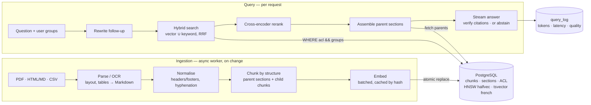
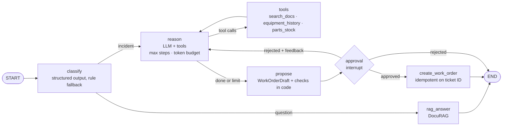

# DocuRAG

Question answering over industrial technical documentation — maintenance manuals (PDF, including
scanned pages and tables), knowledge-base procedures (HTML / Markdown) and business records (CSV) —
with answers cited down to document and page, refusal when the documents don't support an answer,
and an evaluation harness that measures every change.

Python · LangChain · PostgreSQL + pgvector · FastAPI · Azure OpenAI · Azure AI Document Intelligence

> The quality of a RAG system comes from the data, the pipeline and the architecture — the prompt
> is the last lever. This repository is organised around that idea: most of the code is parsing,
> chunking, retrieval, access control and evaluation.

The repository also contains **[MaintAgent](#maintagent)**, a LangGraph agent that uses DocuRAG
to diagnose maintenance incidents and prepare work orders under human approval.

## Architecture



## Design decisions

| Decision | Why | Where |
|---|---|---|
| **Parser per document type, with checks** | Parsing is the first quality bottleneck. Headings come from font size and numbering so sections follow the document; tables are extracted whole as Markdown and their text is not indexed twice; pages without a text layer are reported and routed to OCR instead of silently indexing nothing. | `ingestion/pdf.py`, `ingestion/parsers.py` |
| **Repeated headers/footers removed** | "Manuel P-200 — Rév. C · Page 12/80" on every page pollutes every chunk and every embedding. | `ingestion/normalize.py` |
| **Business data queried, not embedded** | Structured values (status, dates) are answered by SQL tools; only free-text columns of records are indexed. | `ingestion/records.py` |
| **Structure-aware chunks with parents** | Match on small chunks (~400 tokens), give the LLM the whole section (small-to-big), or a window when the section is too long. | `ingestion/chunker.py`, `generation/context.py` |
| **Contextual header on every chunk** | `Manuel P-200 > 4 Couples de serrage` is embedded and indexed with the chunk, so a table row can be found by where it sits. | `ingestion/chunker.py` |
| **Tables never split** (unless huge; then the header row is repeated) and the caption line travels with the table | A torque value separated from its bolt reference is a safety bug, not a retrieval miss. | `ingestion/chunker.py` |
| **Hybrid search in one SQL query** | Vectors catch paraphrases; French full-text catches codes (E-41), part numbers and acronyms that embeddings blur. Fused with Reciprocal Rank Fusion (k = 60); question words are OR-ed so long questions still match. | `db/repository.py` |
| **Access control inside the query** | `acl_groups && user_groups` is in every leg of the search. There is no unfiltered code path; no groups means no results. Tested in every search mode. | `db/repository.py`, `tests/test_db_integration.py` |
| **pgvector details handled** | `halfvec` to index 3,072-d embeddings (HNSW limit: 2,000 for `vector`, 4,000 for `halfvec`); iterative index scans (pgvector ≥ 0.8) so the ACL filter doesn't starve results; `ef_search` configurable. | `db/schema.sql`, `db/pool.py` |
| **Cross-encoder reranking** | Reads question and chunk together; usually the best quality gain per euro. Runs off the event loop. | `retrieval/rerank.py` |
| **Abstention, twice** | Before generation: top rerank score below a threshold calibrated on the eval set. During generation: the model answers `NO_ANSWER`, which is held back from the stream and replaced by a fixed message plus the closest sources. | `service.py` |
| **Citations verified** | Every `[S#]` must point to a source the model was shown; invented ones are stripped and counted. | `generation/context.py` |
| **Retrieved text is data, not instructions** | Sources are wrapped in delimited blocks that their content cannot close; the prompt says so explicitly. | `generation/context.py`, `generation/prompts.py` |
| **Incremental, atomic, versioned ingestion** | A hash of file + pipeline settings skips unchanged documents; ACL-only changes don't re-embed; embeddings are cached by chunk hash; a document's chunks are replaced in one transaction; only the latest version of a `doc_key` is searchable; deletions propagate (`sync --prune`). | `ingestion/pipeline.py`, `db/repository.py` |
| **No mixed index** | The database records the embedding model, dimensions and text-search config; starting with different settings is refused. A model change is a new index, switched over when the eval passes. | `db/pool.py` |
| **Postgres job queue** | Uploads return `202` + job ID; workers claim jobs with `FOR UPDATE SKIP LOCKED`, retry transient failures, requeue jobs lost by a crashed worker. No extra broker to operate. | `worker.py` |
| **Prompts are versioned** | The prompt version is logged with every answer and every eval run. | `generation/prompts.py` |
| **Every answer logged with its cost and timings** | Tokens (incl. cached), latency per stage, abstention, citation counts. Question text is stored only if enabled (GDPR minimisation). | `service.py`, `query_log` table |
| **LangChain where it saves work** | Model clients, embeddings, text splitter, a `BaseRetriever` adapter for agents. Retrieval SQL is hand-written because hybrid search + ACL + versioning need control the generic vector-store abstraction doesn't give. | `providers.py`, `retrieval/retriever.py` |

## Quickstart

Prerequisites: Python 3.11+ and PostgreSQL with **pgvector ≥ 0.7** (0.8+ recommended). The free
setup below needs no local database and no paid API.

```bash
python -m venv .venv && . .venv/bin/activate      # Windows: .venv\Scriptsctivate
pip install -e ".[dev,ollama]"                    # extras: rerank (cross-encoder), azure (OCR + Entra ID), eval (RAGAS)
cp .env.example .env                              # then fill it in (see below)
docurag doctor                                    # checks config, database, models; says how to fix each problem
```

`docurag doctor` is the entry point whenever something doesn't work: it validates `.env`, connects to
the database (and flags Neon's pooled endpoint), checks pgvector and whether the index matches the
settings, lists the Ollama models that still need pulling, measures one embedding and one chat call,
checks that the model actually calls tools, and reports the reranker's device.

### Free setup: hosted database, local models

The code is provider-agnostic: develop on free local models, deploy on Azure OpenAI by changing
settings, not code.

| Piece | Free choice | Notes |
|---|---|---|
| PostgreSQL + pgvector | [Neon](https://neon.tech) free tier, EU region | pgvector is available to the default role. Use the **direct** connection string, not the `-pooler` one: the app pools its own connections. Pooled connections are checked before use, because a free Neon database suspends after 5 idle minutes. |
| Chat model | Ollama, `mistral-nemo` (12B) on a 16 GB GPU | A non-reasoning model on purpose: a "thinking" preamble would defeat the `NO_ANSWER` sentinel. |
| Embeddings | Ollama, `bge-m3` (1,024 dimensions, multilingual) | `DOCURAG_EMBEDDING_DIMENSIONS=1024` must be set before `init-db`. |
| Reranker | `BAAI/bge-reranker-v2-m3` via sentence-transformers | Optional. PyPI's Windows PyTorch wheel is CPU-only (slow here); for a GPU — CUDA 12.8+ for RTX 50-series — install PyTorch from `https://download.pytorch.org/whl/cu128` before the `rerank` extra. About 5 GB with the model. |

`.env.example` ends with the free profile. Ollama's default context window is small:
`DOCURAG_OLLAMA_NUM_CTX` (default 8192) must cover the context budget plus the prompt and the answer,
or Ollama cuts the sources without any error — the settings refuse a window that is too small.

### First run

```bash
ollama pull mistral-nemo && ollama pull bge-m3
docurag doctor                                    # everything [ ok ] except "index": expected
docurag init-db                                   # schema + pgvector extension
docurag sync examples/corpus/manifest.toml        # ingest the example corpus
maintagent seed examples/business                 # equipment registry + intervention history
pytest -m db                                      # database tests, in throwaway schemas
docurag ask "Quel couple de serrage pour le carter ?" --groups maintenance
docurag eval --dataset examples/eval/questions.jsonl --groups maintenance --label baseline
maintagent submit GMAO-0001 "Pompe P-200-07 : vibrations fortes et alarme E-41" --user tech-42 --groups maintenance
maintagent serve                                  # DocuRAG + MaintAgent API on http://127.0.0.1:8000/docs
docurag worker                                    # processes uploaded documents (separate terminal)
```

`DOCURAG_PROVIDER=fake` runs everything offline — deterministic embeddings, an extractive stand-in
for the LLM, rule-based tool calls for the agent — to check the plumbing; it says nothing about quality.

<details>
<summary>Self-hosted PostgreSQL instead of Neon</summary>

```sql
CREATE ROLE docurag LOGIN PASSWORD 'choose-one';
CREATE DATABASE docurag OWNER docurag;
\c docurag
CREATE EXTENSION vector;
```

pgvector on Windows, from an "x64 Native Tools Command Prompt for VS 2022" run as administrator
(verified with pgvector 0.8.6 on PostgreSQL 17):

```bat
set "PGROOT=C:\Program Files\PostgreSQL"
cd %TEMP%
git clone --branch v0.8.6 https://github.com/pgvector/pgvector.git
cd pgvector
nmake /F Makefile.win
nmake /F Makefile.win install
```

`DOCURAG_DB_SCHEMA` puts the tables in their own schema if the database is shared. Managed
alternative: Azure Database for PostgreSQL (Flexible Server) ships pgvector — allow-list `vector`
in `azure.extensions`.
</details>

## Corpus manifest

The manifest lists documents, their logical key and version, and who may read them. `docurag sync`
brings the index in line with it; `--prune` deletes documents that left it.

```toml
uri_prefix = "corpus://maintenance/"
[defaults]
acl_groups = ["maintenance"]

[[documents]]
path = "manuals/pompe_p200_rev_c.pdf"
doc_key = "manual-p200"          # versions of the same document share a key
version = "C"                    # only the latest version is searchable
acl_groups = ["maintenance", "methodes"]

[[documents]]
path = "records/interventions.csv"
record_id_field = "ot_id"
record_text_fields = ["symptome", "diagnostic", "action"]
```

## API

| Endpoint | Behaviour |
|---|---|
| `POST /v1/ask` | JSON answer with citations, sources, abstention flag, token usage and timings per stage. |
| `POST /v1/ask/stream` | Server-sent events: `sources`, `token`…, `done`. The `done` event carries the verified text and citations and is authoritative. Client disconnect stops generation. |
| `POST /v1/documents` | Multipart upload (admin group). Returns `202` with a job ID and `Location` header; parsing and embedding run in the worker. Re-uploading the same `source_uri` replaces the document. |
| `GET /v1/jobs/{id}` | Job status and the ingestion report (pages, chunks, warnings). |
| `GET · DELETE /v1/documents/{id}` | Document metadata and report · deletion (cascades to chunks). |
| `GET /healthz` · `/readyz` | Liveness · database readiness. |

Authentication: `DOCURAG_AUTH_MODE=jwt` validates Entra ID / OIDC bearer tokens against the issuer's
JWKS, and the user's groups (or app roles: `DOCURAG_JWT_GROUPS_CLAIM=roles`, which avoids Entra's
group-overage limit) become the retrieval filter. `dev` mode trusts `X-Dev-User` / `X-Dev-Groups`
headers and is refused when `DOCURAG_ENV=prod`. Errors are `application/problem+json` (RFC 9457)
with the request ID; `X-Request-ID` from the caller is propagated into logs.

## Evaluation

The eval set is JSON Lines: question, reference answer, category, and the relevant sources (document,
optionally pages). Unanswerable questions have `"relevant": []` — the system must refuse them.
`examples/eval/questions.jsonl` shows the format; a real set needs 100–200 questions written or
reviewed by someone who knows the domain, with ~10–15 % unanswerable.

Retrieval and generation are scored separately, so a regression points to its stage:

| Metric | Measures |
|---|---|
| `candidates_recall@k`, `candidates_mrr` | first-stage (hybrid) retrieval |
| `final_recall`, `final_mrr` | after reranking, what the LLM actually sees |
| `abstention_correct`, `answered_when_answerable`, `abstained_when_unanswerable` | refusal behaviour |
| `cited_relevant`, `invalid_citations` | grounding of citations |
| `ragas_faithfulness`, `ragas_answer_relevancy`, `ragas_llm_context_precision_with_reference`, `ragas_context_recall` | with `--ragas` (judge model via `--judge-model`) |
| `total_ms_p50/p95`, `first_token_ms_p50/p95`, tokens | cost and latency |

Compare configurations against a baseline:

```bash
docurag eval --dataset eval/questions.jsonl --groups maintenance --label vector --mode vector --no-rerank
docurag eval --dataset eval/questions.jsonl --groups maintenance --label hybrid --no-rerank \
  --baseline eval/results/<vector-run>.json
DOCURAG_RERANKER=cross-encoder docurag eval --dataset eval/questions.jsonl --groups maintenance \
  --label hybrid-rerank --calibrate --ragas --judge-model <judge-deployment> \
  --baseline eval/results/<hybrid-run>.json
```

`--calibrate` suggests `DOCURAG_ABSTAIN_THRESHOLD` from the top rerank scores of answerable vs
unanswerable questions.

### Results

To be filled from real runs on a real corpus — never estimated.

| Configuration | final_recall | final_mrr | faithfulness | abstention_correct | p95 latency | tokens / answer |
|---|---|---|---|---|---|---|
| vector only | [X] | [X] | [X] | [X] | [X] | [X] |
| hybrid (RRF) | [X] | [X] | [X] | [X] | [X] | [X] |
| hybrid + rerank | [X] | [X] | [X] | [X] | [X] | [X] |

## Build a real corpus

The example corpus is there to exercise the pipeline. For a meaningful evaluation, use public,
messy technical documents: equipment manuals published by manufacturers, public aviation or rail
regulations (long PDFs with tables and numbered sections), and a few scanned pages (OCR route).
Keep several versions of one document to exercise versioning.

## MaintAgent

A technician reports a fault — *« Pompe P-200-07 : vibrations et alarme E-41 »*. The agent
classifies the request; a documentation question goes straight to DocuRAG. An incident goes into
a bounded diagnosis loop with three tools, ends in a typed work-order proposal checked in code,
and waits for a supervisor. Nothing is written to the maintenance system (GMAO) before approval.



| Decision | Why | Where |
|---|---|---|
| **One open loop inside a fixed workflow** | Routing, proposal and approval are fixed steps; only the diagnosis needs the model to choose its next action. Cost and behaviour stay predictable. | `maintagent/graph.py` |
| **Tools designed like public APIs** | Three narrow tools with typed arguments (unexpected fields refused), descriptions that say when *not* to use them, compact JSON output. | `maintagent/tools.py` |
| **Failures are observations** | Unknown tool, invalid arguments, timeout or crash come back to the model as a structured error; the run continues. Every tool call gets an answer, including those over the parallel-call cap — otherwise the next model call is rejected. | `maintagent/tools.py`, `graph.py` |
| **The model can't choose whose access it uses** | The requester's groups come from the ticket state and are injected into `search_docs`; a `groups` argument from the model is refused. The agent inherits DocuRAG's access filter. | `maintagent/tools.py` |
| **The only write is not a tool** | Creating the work order is a graph step after `interrupt()`. The approver must be a supervisor and not the requester. The ticket ID is the idempotency key, so a retry or a resumed run can't create a second order. | `maintagent/graph.py`, `service.py`, `business.py` |
| **Bounded by construction** | Step limit, token budget, rejection limit and a LangGraph recursion limit. When a limit is hit, the agent still proposes what it has, flagged *incomplete*, and never sends unexecuted tool calls back to the model. | `maintagent/graph.py` |
| **Built for small models that fail** | Structured outputs get one corrective retry, then a deterministic fallback: rule-based classification, or a minimal draft flagged incomplete. A ticket never fails because a model returned bad JSON. | `maintagent/graph.py` |
| **Proposals checked in code** | Invented source IDs are removed and reported; the equipment must exist; parts must be known to the ERP and in stock. The supervisor sees these issues next to the proposal. | `maintagent/graph.py` |
| **Durable runs** | `AsyncPostgresSaver` checkpoints after every step, keyed by ticket. A crash leaves the ticket *stalled* and resumable; an approval given after a restart still completes (tested). | `maintagent/container.py`, `service.py` |
| **Read paths can't write** | Business data is read through views, with bound parameters, inside `READ ONLY` transactions. | `maintagent/business.py` |
| **ERP client with bounded retries** | Timeouts, retries with backoff on 429/5xx honouring `Retry-After`, no retry on client errors. The mock ERP can inject failures to watch it work. | `maintagent/erp.py`, `mock_erp.py` |
| **Evaluated on trajectories** | Scenarios state the expected intent, equipment and tools. Measured: task success, tool recall, steps within bounds, writes gated by approval, idempotent creation, tokens and latency. | `maintagent/evaluation.py` |

Run it (after `docurag sync` of the example corpus):

```bash
maintagent seed examples/business      # equipment registry + intervention history
maintagent submit GMAO-0001 "Pompe P-200-07 : vibrations fortes et alarme E-41" --user tech-42 --groups maintenance
maintagent decide GMAO-0001 --approve --user sup-7 --groups maintenance,maintenance-supervisor
maintagent eval --scenarios examples/agent/scenarios.jsonl --approve-as sup-7
maintagent serve                        # DocuRAG endpoints + ticket endpoints in one API
```

The mock ERP runs inside the app by default (`MAINTAGENT_ERP_BASE_URL=inprocess`) through the same
HTTP client, retries and timeouts as a real ERP. To watch the retries against a flaky server, run
`maintagent erp --failure-rate 0.3` and set `MAINTAGENT_ERP_BASE_URL=http://127.0.0.1:8081`.

| Endpoint | Behaviour |
|---|---|
| `POST /v1/tickets` | Runs the agent until it answers or a proposal awaits approval. Submitting the same ticket ID again returns the same run. |
| `GET /v1/tickets/{id}` | Status, proposal, issues found by the checks, tool-call log, tokens. Visible to the requester and supervisors only. |
| `POST /v1/tickets/{id}/decision` | Supervisor approval or rejection (with feedback, the agent revises). `403` for non-supervisors and for the requester, `409` when nothing is pending. |
| `POST /v1/tickets/{id}/resume` | Resumes a stalled run from its last checkpoint. |

Agent settings use the `MAINTAGENT_` prefix (`MAX_STEPS`, `TOKEN_BUDGET`, `TOOL_TIMEOUT_S`,
`ERP_BASE_URL`, `SUPERVISOR_GROUP`, …); see `maintagent/config.py`.

## Tests

```bash
pytest                   # everything; database tests skip unless DOCURAG_TEST_DATABASE_URL is set
pytest -m db             # database tests only (DOCURAG_TEST_DATABASE_URL in the environment or .env)
```

Each database test runs in its own throwaway schema, dropped afterwards, so the application's
database can be reused. They were run against PostgreSQL 17 with pgvector 0.8.6 and cover: no ACL leak in any search mode, exact-code
retrieval through the keyword leg, incremental ingestion (unchanged / ACL-only / changed with cache
hits), latest-version-only search, deletion propagation, the job queue and worker, refusal to start
on an index built with other settings, and an end-to-end cited answer.

Agent tests replace the LLM with scripted responses and the tools' backends with in-memory fakes,
so every path runs offline: tool failures as observations, step and token limits, rejection with
feedback, the four-eyes rule, crash and resume, structured-output fallbacks, and the model trying
to pass its own access groups. The agent's database tests cover read-only enforcement, idempotent
work orders, and a pending approval surviving a process restart.

**Ollama contract tests** run without Ollama: a fake server speaks Ollama's HTTP API (streamed
NDJSON, tool calls, JSON-schema structured output, `/api/embed`) and the real `langchain-ollama`
clients built by `providers.py` go through both pipelines. They check what scripted models can't:
how tool calls and tool results are converted, that the context window and temperature reach
Ollama, structured-output retries, token usage, and a `NO_ANSWER` split across stream chunks.

### Performance

Measured on 20,000 synthetic chunks (1,024-d `halfvec`, local PostgreSQL 17 + pgvector 0.8.6,
median of 5 runs, worst case where the query's words appear in every chunk):

| Search | Latency | Notes |
|---|---:|---|
| Vector, filter matching 98 % of chunks | 9 ms | HNSW index used (checked with `EXPLAIN`) |
| Vector, filter matching 2 % | 11 ms | planner switches to an exact scan via the ACL index |
| Hybrid, filter matching 98 % | 37 ms | was 287 ms before two fixes, below |
| Hybrid, filter matching 2 % | 14 ms | |

The two fixes, both found by measuring: `ts_rank` instead of `ts_rank_cd` (cover density was 29×
slower on chunks of realistic length), and a `MATERIALIZED` query CTE — once inlined by the
planner, the `tsquery` was rebuilt and parsed again for every ranked row. Building the HNSW index
for 20,000 vectors took 25 s. Against a hosted database, add the network round trip.

## Layout

```
src/docurag/
  ingestion/   pdf.py · markup.py · records.py · ocr.py · normalize.py · chunker.py · pipeline.py · manifest.py
  db/          schema.sql · pool.py · repository.py
  retrieval/   retriever.py · rerank.py
  generation/  prompts.py · context.py
  evaluation/  dataset.py · metrics.py · runner.py
  api/         app.py · auth.py · errors.py
  service.py · worker.py · container.py · providers.py · cli.py
src/maintagent/
  graph.py · tools.py · service.py · business.py · erp.py · mock_erp.py · api.py · evaluation.py · cli.py
```

## Known limitations and next steps

- **Lexical ranking** uses PostgreSQL `ts_rank`, which has no IDF — not true BM25 — and ranks every
  matching chunk: a query whose words appear in most chunks costs ~26 ms at 20,000 chunks. At large
  scale, or if the eval shows lexical misses, a BM25 extension or a dedicated engine is next.
- **PDF heading detection** is heuristic (font size, numbering). Multi-column layouts and unusual
  styles are better served by the Document Intelligence layout model (`DOCURAG_OCR_BACKEND=azure-di`).
- **Streamed tokens** may contain a citation that is later stripped; clients should render the
  `done` event's text as final.
- **Figures and diagrams** are not described; a vision-model caption step would be the next
  ingestion feature.
- **Uploaded files** are not removed from storage when their document is deleted.
- **Agent not yet validated on a real model.** The Ollama wire format is contract-tested, but the
  tool-calling quality of a small local model is the main risk; `docurag doctor` checks that the
  model calls tools at all, and the scenario eval measures how well.
- **Ticket submission is synchronous** — it runs until the approval gate. With slow local models
  that can take tens of seconds; the next step is `202` + a background run + polling or webhook.
- **Work orders go to a local table** standing in for the GMAO. A real integration calls the GMAO
  API with the ticket ID as `Idempotency-Key`.
- **Checkpoints keep the report text**: a retention policy is needed before real use (GDPR).
- **Not in scope here**: semantic cache, per-tenant quotas and cost dashboards (the API gateway
  layer).
